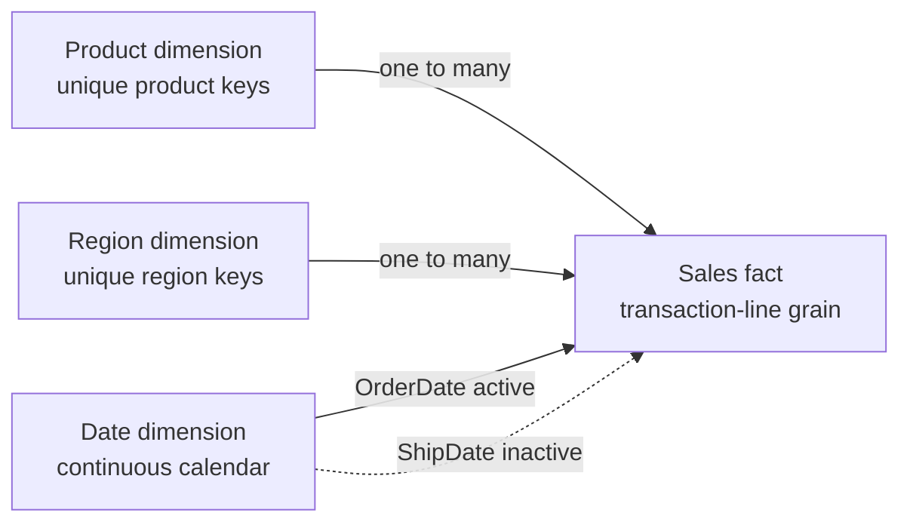

# Model design and time intelligence

Correct formulas still depend on correct grain, relationships, and dates.
Use dimensions for grouping and a fact table for transaction-level values.



Use single-direction filtering from dimension to fact for this learning
model. Bidirectional filtering and many-to-many relationships need deliberate
design; they are not automatic repairs for unexpected totals.

## Classic time intelligence

The companion examples use **classic date-column time intelligence**. They
require an appropriate continuous date table, an active date relationship,
and marking the date table as described in that model's setup.

```dax
Revenue YTD =
TOTALYTD ( [Revenue], DimDate[Date] )
```

```dax
Revenue PY =
CALCULATE ( [Revenue], SAMEPERIODLASTYEAR ( DimDate[Date] ) )
```

Use date dimension fields in visuals. A text YearMonth label alone does not
replace a continuous Date column; sort labels using a numeric chronological
key. The companion calendar covers 2025-2026, not a universal fiscal calendar.

## Read the comparison's assumptions

On the **companion** fixture:

| Period | Current Revenue | Prior Year | YTD |
| --- | ---: | ---: | ---: |
| January 2026 | 2400 | 1100 | 2400 |
| February 2026 | 3700 | 2300 | 6100 |

February growth is `(3700-2300)/2300`, about **60.87%**. YTD resets at the year
boundary. Prior-year results for 2025 are blank because this practice calendar
contains no 2024 dates.

These values cannot be reproduced from the three-row Overview query; import
the [full companion model](https://cloud2br-msftlearninghub.github.io/DAX-For-Everyone/model-setup.html)
and run its
[time query](https://cloud2br-msftlearninghub.github.io/DAX-For-Everyone/downloads/queries/04-time.dax).

## Alternate dates answer a different question

```dax
Revenue by Ship Date =
CALCULATE (
    [Revenue],
    USERELATIONSHIP ( DimDate[Date], Sales[ShipDate] )
)
```

USERELATIONSHIP uses an **existing** relationship; it does not create one.
The inactive ShipDate relationship lets an individual measure answer a
shipment question instead of an order-date question. The companion has
February 2026 order revenue 3700, February shipped revenue 3300, and March
shipped revenue 400.

RLS restrictions can affect whether USERELATIONSHIP is supported in a
particular model/security context. Do not assume a Desktop role test proves
service permissions are correct.

## Product features evolve

Newer calendar-based time intelligence has different setup and function
capabilities. This overview does not silently mix it with classic examples
or claim fiscal-week support. Check current
[Microsoft date-table guidance](https://learn.microsoft.com/en-us/power-bi/transform-model/desktop-date-tables)
and the companion
[time-intelligence lesson](https://cloud2br-msftlearninghub.github.io/DAX-For-Everyone/time-intelligence.html).
